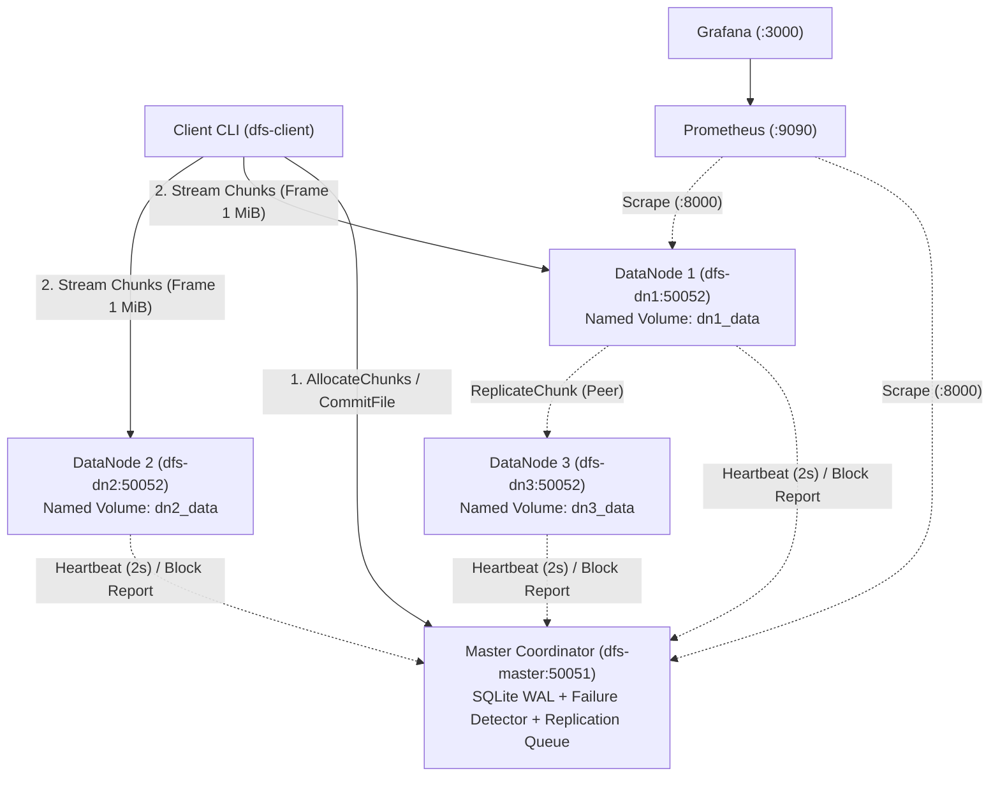

# DFS-X Terminal — Mini Distributed File System

> **Tema 5:** Cloud-based Distributed File Storage (DFS-X)  
> **Mata Kuliah:** Komputasi Paralel dan Terdistribusi (3 SKS) — UAS Ganjil 2026/2027  
> **Stack:** Python 3.12 (Pure) · gRPC Streaming · Podman/WSL2 · SQLite WAL · Prometheus & Grafana

DFS-X Terminal adalah implementasi sistem berkas terdistribusi mini berbasis CLI, gRPC streaming, dan arsitektur container. Proyek ini mendemonstrasikan koordinasi master-worker, replikasi data dengan anti-affinity ($RF=2$), verifikasi integritas data berbasis SHA-256 bertingkat, pemulihan mandiri saat kegagalan (*fault recovery*), pengujian skalabilitas (2 hingga 16 node), serta visualisasi metrik performa sesuai standar evaluasi ilmiah.

---

## 🎯 Project Overview

DFS-X adalah **Mini Distributed File System** yang mensimulasikan konsep distributed file storage dengan koordinasi master-worker, replikasi, dan fault recovery. Sistem ini dibangun untuk memenuhi tugas UAS Komputasi Paralel dan Terdistribusi (Tema 5).

**Konsep utama:**

```text
File
  ↓
Chunking (partisi ke chunk 8 MiB)
  ↓
Distributed Storage (chunk tersebar ke DataNode)
  ↓
Replication (RF=2, anti-affinity)
  ↓
Fault Detection (heartbeat 2s / timeout 10s)
  ↓
Recovery / Failover (re-replikasi otomatis)
```

Tujuan sistem adalah menunjukkan bagaimana file dapat tetap tersedia ketika sebagian node mengalami kegagalan, serta menganalisis performa (speedup, efisiensi, throughput, latensi) dan skalabilitas (2 hingga 16 node).

---

## 📋 Daftar Isi

1. [Project Overview](#-project-overview)
2. [Fitur Utama & Arsitektur](#-fitur-utama--arsitektur)
3. [Topologi Cluster](#-topologi-cluster)
4. [Distributed File Model](#-distributed-file-model)
5. [Replication](#-replication)
6. [Chunk Placement](#-chunk-placement)
7. [Communication Layer](#-communication-layer)
8. [Upload Flow](#-upload-flow)
9. [Download Flow](#-download-flow)
10. [Data Integrity](#-data-integrity)
11. [Failure Detection](#-failure-detection)
12. [Fault Recovery](#-fault-recovery)
13. [Prasyarat Sistem](#-prasyarat-sistem)
14. [Panduan Mulai Cepat (Quickstart)](#-panduan-mulai-cepat-quickstart)
15. [Menjalankan Cluster DFS-X](#-menjalankan-cluster-dfs-x)
16. [Operasi CLI (Upload, Download, Verifikasi)](#-operasi-cli-upload-download-verifikasi)
17. [Pengujian Toleransi Kegagalan (Fault Tolerance F1-F6)](#-pengujian-toleransi-kegagalan-fault-tolerance-f1f6)
18. [Performance Metrics](#-performance-metrics)
19. [Performance Evaluation](#-performance-evaluation)
20. [Scalability Experiment](#-scalability-experiment)
21. [Interpretasi Hasil](#-interpretasi-hasil)
22. [Benchmarking & Skalabilitas (2 hingga 16 Node)](#-benchmarking--skalabilitas-2-hingga-16-node)
23. [Monitoring Stack (Prometheus & Grafana)](#-monitoring-stack-prometheus--grafana)
24. [Experimental Limitations](#-experimental-limitations)
25. [Compliance Tema 5](#-compliance-tema-5)
26. [Evidence & Results](#-evidence--results)
27. [Final Project Summary](#-final-project-summary)
28. [Project Structure](#-project-structure)
29. [Testing](#-testing)
30. [Pemeliharaan & Pembersihan Resource Disk](#-pemeliharaan--pembersihan-resource-disk)
31. [Panduan Video Demo (Max 10 Menit)](#-panduan-video-demo-max-10-menit)
32. [Troubleshooting Umum](#-troubleshooting-umum)
33. [Cheat Sheet: PowerShell + Podman (Windows 10/11)](#-cheat-sheet-powershell--podman-windows-1011)
34. [Kepatuhan & Aturan Teknis (Rules of Engagement)](#-kepatuhan--aturan-teknis-rules-of-engagement)

---

## 🚀 Fitur Utama & Arsitektur

- **Master Coordinator:** Mengelola alokasi chunk, deteksi kegagalan node via heartbeat monolitik (`time.monotonic()`), pemulihan replika otomatis berbasis antrean (`queue.Queue`), dan metadata ACID menggunakan SQLite WAL.
- **Worker (DataNode):** Menyimpan chunk sebesar 8 MiB dengan penulisan atomik (`.tmp` + `os.replace`), penolakan alokasi otomatis jika disk rendah (`MIN_FREE_MB`), streaming chunk antar-node (*peer replication*), dan pelaporan berkala (*block report*).
- **Client CLI:** Pengunggahan dan pengunduhan multi-worker konkuren menggunakan gRPC streaming 1 MiB frame, verifikasi checksum bertingkat (SHA-256 per chunk dan per berkas), serta failover unduhan dinamis jika primer offline atau terjadi *checksum mismatch*.
- **Parameter Evaluasi Lengkap:** Mengukur dan memvisualisasikan 6 metrik wajib: Speedup Ratio ($S$), Efficiency ($E$), Throughput (MiB/s & task/detik), Latency (avg, p50, p95, p99), Fault Recovery, dan Skalabilitas (2, 3, 4, 8, 16 node).

---

## 🏗 Topologi Cluster



---

## 📂 Distributed File Model

File tidak disimpan sebagai satu objek besar. File dibagi menjadi chunk yang tersebar ke DataNode.

```text
example.bin (50 MiB)
│
├── Chunk 0 (8 MiB)  → DN1, DN3
├── Chunk 1 (8 MiB)  → DN2, DN1
├── Chunk 2 (8 MiB)  → DN3, DN2
├── Chunk 3 (8 MiB)  → DN1, DN3
├── Chunk 4 (8 MiB)  → DN2, DN1
├── Chunk 5 (8 MiB)  → DN3, DN2
└── Chunk 6 (2 MiB)  → DN1, DN3
```

Setiap chunk memiliki replica di DataNode berbeda (anti-affinity). Hubungan:
- **Partitioning/Chunking** → membagi file besar ke unit kecil yang dapat didistribusikan.
- **Replication** → setiap chunk disalin (RF=2) untuk ketersediaan.
- **Availability** → file tetap dapat diakses selama minimal 1 replika hidup.
- **Recovery** → jika replika hilang, master menyalin dari replika ALIVE ke node lain.

---

## 🔁 Replication

Konfigurasi utama menggunakan **Replication Factor (RF) = 2**. Artinya setiap chunk memiliki dua salinan pada DataNode yang berbeda.

**Anti-affinity:**

```text
Valid (replika di node berbeda):
Chunk A
├── DN1
└── DN2

Tidak diinginkan (replika di node sama):
Chunk A
├── DN1
└── DN1
```

Manfaat anti-affinity: kegagalan satu node tidak menghilangkan semua salinan chunk. Master memilih node target dengan beban terendah (`pick_targets`) dan memastikan dua replika tidak berada di node yang sama.

---

## 📍 Chunk Placement

Master menentukan lokasi chunk berdasarkan mekanisme alokasi:

```text
Client
   │
   │ AllocateChunks (filename, file_size, chunk_size, overwrite)
   ▼
Master (pick_targets: pilih node beban terendah, anti-affinity)
   │
   ├──────► DN1 (replika 1)
   │
   └──────► DN3 (replika 2)
```

Master mengembalikan `ChunkPlan` berisi `chunk_id`, `index`, `size`, dan `targets` (node_id + address). Client kemudian stream data ke tiap target.

---

## 📡 Communication Layer

- **Protokol:** gRPC (HTTP/2) + Protocol Buffers.
- **Streaming:** StoreChunk / RetrieveChunk menggunakan stream 1 MiB frame.
- **Deadline:** control RPC 5 s, transfer RPC 60 s.
- **Retry:** 3× pada `UNAVAILABLE`/`DEADLINE_EXCEEDED`.
- **Channel:** di-cache per node (bukan per chunk) untuk efisiensi koneksi.
- **Frame size:** `FRAME = 1 << 20` (1 MiB), didefinisikan di `common/grpc_util.py`.

Streaming memungkinkan transfer data besar tanpa memuat seluruh berkas ke memori. Incremental SHA-256 memverifikasi integritas per frame.

---

## ⬆️ Upload Flow

```text
Client
  │
  │ 1. AllocateChunks (filename, file_size, chunk_size, overwrite)
  ▼
Master
  │
  │ 2. ChunkPlan (chunk_id, index, size, targets dengan anti-affinity)
  ▼
Client
  │
  │ 3. Stream StoreChunk (frame 1 MiB) ke tiap target
  ▼
DataNode (replika 1) + DataNode (replika 2)
  │
  │ 4. StoreChunk response (ok, checksum)
  ▼
Client
  │
  │ 5. ReallocateChunk (jika replika gagal)
  ▼
Master
  │
  │ 6. CommitFile (upload_id, filename, file_checksum, chunks)
  ▼
Master (metadata + SQLite WAL)
  │
  │ 7. CommitResponse (ok, under_replicated)
  ▼
Upload selesai (UPLOAD_COMMIT)
```

Langkah aktual:
1. Client mengirim `AllocateRequest`.
2. Master mengembalikan `ChunkPlan` dengan target anti-affinity.
3. Client stream `StoreChunk` ke tiap target (frame 1 MiB, incremental SHA-256).
4. Jika replika gagal (node mati), `ReallocateChunk` memilih node lain.
5. Client mengirim `CommitFile` dengan checksum gabungan.
6. Master menyimpan metadata di SQLite WAL dan mengembalikan `CommitResponse`.
7. Upload selesai, log `UPLOAD_COMMIT`.

---

## ⬇️ Download Flow

```text
Client
  │
  │ 1. GetReadLocations (filename)
  ▼
Master
  │
  │ 2. ChunkLocation (chunk_id, index, size, checksum, replicas)
  ▼
Client
  │
  ├──────► Replica A (RetrieveChunk stream)
  │
  └──────► Replica B (fallback jika A gagal/checksum mismatch)
  │
  │ 3. os.pwrite per chunk (offset berurutan)
  ▼
Client (verifikasi file checksum gabungan)
  │
  │ 4. Hapus parsial jika gagal
  ▼
Download selesai (DOWNLOAD_OK)
```

Client membaca dari replika pertama yang lolos checksum. Jika gagal atau checksum mismatch, fallback ke replika berikutnya. Setelah semua chunk terkumpul, verifikasi file checksum gabungan (SHA-256 gabungan per chunk).

---

## 🔐 Data Integrity

Checksum bertingkat:

```text
Frame (1 MiB) → SHA-256 per frame
   ↓
Chunk → SHA-256 gabungan per chunk (combine_checksums)
   ↓
File → SHA-256 gabungan per berkas
```

- **Per frame:** incremental SHA-256 saat streaming.
- **Per chunk:** checksum gabungan dari frame-frame.
- **Per berkas:** checksum gabungan dari chunk-chunk.
- **Verifikasi:** saat upload, master membandingkan checksum chunk dari client dengan yang disimpan. Saat download, client membandingkan checksum chunk dari datanode dengan metadata.
- **Fallback:** jika checksum mismatch, client mencoba replika berikutnya.

**Uji korupsi (F5):** modifikasi 1 byte chunk di disk → deteksi `CHECKSUM_MISMATCH` → fallback ke replika lain → download tetap berhasil.

---

## 🔍 Failure Detection

```text
DN1 ── heartbeat (2s) ──► Master
DN2 ── heartbeat (2s) ──► Master
DN3 ── heartbeat (2s) ──► Master
```

- DataNode mengirim heartbeat tiap 2 s (`HEARTBEAT_INTERVAL_S`).
- Master menandai node DOWN jika tidak ada heartbeat dalam 10 s (`HEARTBEAT_TIMEOUT_S`).
- Master scan tiap 2 s (`SCAN_INTERVAL_S`).
- Saat node DOWN, master menandai chunk under-replicated dan memasukkan ke replication queue.

---

## 🔄 Fault Recovery

```text
Initial:
Chunk A
├── DN1
└── DN2

DN2 fails:
Chunk A
└── DN1 (under-replicated)

Recovery (auto re-replicate):
Chunk A
├── DN1
└── DN3 (replika baru)
```

- Master mendeteksi chunk under-replicated saat scan.
- Replication queue memilih sumber = ALIVE holder (bukan node kosong).
- Worker thread menyalin chunk dari sumber ke target (concurrency 2).
- Setelah selesai, master menambahkan target ke `cm.replicas`.
- Anti-affinity dijaga: target ≠ source.

**Uji (F1–F6):** semua skenario lulus, termasuk stop node saat upload (realokasi on-the-fly), auto-repair, node rejoin, download saat offline, korupsi chunk, dan restart master (SQLite WAL).

---

## 💻 Prasyarat Sistem

- **OS:** Windows 10/11 (dengan WSL2 aktif) atau Linux.
- **Container Engine:** [Podman](https://podman.io/) (v4.x/5.x/6.x) dengan `podman-compose`.
- **Python:** Python 3.12+ (disarankan) pada host untuk skrip visualisasi dan orchestrator benchmark.

---

## ⚡ Panduan Mulai Cepat (Quickstart)

### 1. Clone Repository

```bash
git clone https://github.com/Raka-coder/mini-dfs-container.git
cd mini-dfs-container
```

### 2. Persiapan Lingkungan Virtual & Dependensi

Siapkan environment Python pada mesin host untuk menjalankan skrip pengujian, benchmark, dan visualisasi:

```bash
# Windows (PowerShell)
python -m venv .venv
.venv\Scripts\activate

# Linux / WSL2 (Bash)
python3 -m venv .venv
source .venv/bin/activate

# Install dependensi
pip install -r requirements.txt -r requirements-build.txt
pip install podman-compose matplotlib pandas ruff pytest
```

### 3. Kompilasi Protobuf gRPC

Generate stubs gRPC Python dari berkas definisi protokol:

```bash
python -m grpc_tools.protoc -I. --python_out=. --grpc_python_out=. proto/dfs.proto
```

### 4. Build Container Image

Bangun satu image terpadu `localhost/dfsx:latest` untuk seluruh layanan (Master, DataNode, Client):

```bash
podman build -t localhost/dfsx:latest .
```
*(Alternatif menggunakan helper Python: `python scripts/cluster.py build`)*

---

## 🐳 Menjalankan Cluster DFS-X

### Menjalankan Cluster Default (1 Master + 3 DataNodes + 1 Client)

Metode utama (stabil di Podman Windows/WSL2):

```bash
python scripts/cluster.py build            # build image localhost/dfsx:latest
python scripts/cluster.py down -v          # bersihkan cluster + volume (opsional)
python scripts/cluster.py up --nodes 3     # 1 master + 3 datanode + 1 client
```

Alternatif (hanya jika aardvark-dns berfungsi di VM Anda):

```bash
podman-compose -p dfsx up -d
```

> **Catatan:** Di Podman Windows/WSL2, `podman-compose` sering gagal karena `aardvark-dns`
> tidak bisa start. Jika gagal, gunakan metode utama di atas (lihat juga bagian
> "Metode Deploy Stabil" dan Cheat Sheet bagian F).

### Metode Deploy Stabil (WSL2 / Podman Windows)

Di lingkungan Podman Windows (WSL2 backend) komponen `aardvark-dns` sering gagal start sehingga `podman-compose` tidak bisa resolve nama container. Metode yang terbukti stabil adalah **menjalankan container satu per satu dengan `--network dfsnet` (tanpa DNS)**, di mana setiap container mendapat static IP dan entri `/etc/hosts` via `--add-host`. Orkestrator ini sudah diimplementasikan di `scripts/cluster.py`:

```bash
python scripts/cluster.py build                  # build image localhost/dfsx:latest
python scripts/cluster.py down -v               # bersihkan cluster + volume
python scripts/cluster.py up --nodes 3          # 1 master + 3 datanode + 1 client
python scripts/cluster.py up --nodes 16         # skalabilitas hingga 16 node
```

Network `dfsnet` dibuat dengan `--disable-dns --subnet 10.90.0.0/24`; master di `10.90.0.13`, datanode `10.90.0.14..`, client `10.90.0.14+N`. Semua container mendapat `--add-host` untuk tiap nama sehingga resolusi nama berfungsi tanpa DNS. **Gunakan metode ini** untuk eksperimen; `podman-compose` hanya referensi.

### Memeriksa Status & Kesiapan Cluster

Pastikan seluruh node telah terhubung dan berstatus `ALIVE`:

```bash
# Tunggu hingga master mendeteksi minimal 3 node aktif
podman exec dfs-client python -m client.cli wait-ready --min-nodes 3 --timeout 60

# Cek tabel status cluster
podman exec dfs-client python -m client.cli status
```

---

## 📦 Operasi CLI (Upload, Download, Verifikasi)

Semua operasi klien dieksekusi secara terisolasi di dalam container `dfs-client`:

### Generate Dataset Pengujian

```bash
# Profil lite (10 berkas x 5 MB sparse) untuk verifikasi cepat
podman exec dfs-client python -m client.cli gen-data --profile lite

# Profil full (100 berkas x 50 MB data acak nyata / os.urandom untuk benchmark final)
podman exec dfs-client python -m client.cli gen-data --profile full --batch 20
```

### Upload & Download Berkas

```bash
# Upload berkas tunggal
podman exec dfs-client python -m client.cli upload /work/testdata/f001.bin f001.bin

# Download berkas kembali
podman exec dfs-client python -m client.cli download f001.bin /work/out_000.bin

# List seluruh berkas di DFS-X
podman exec dfs-client python -m client.cli ls
```

### Pemeriksaan Metadata & Verifikasi Integritas

```bash
# Tampilkan detail alokasi chunk dan letak replika anti-affinity
podman exec dfs-client python -m client.cli info f001.bin

# Verifikasi integritas checksum SHA-256 berkas
podman exec dfs-client python -m client.cli verify f001.bin

# Hapus berkas
podman exec dfs-client python -m client.cli rm f001.bin
```

---

## 🛡 Pengujian Toleransi Kegagalan (Fault Tolerance F1–F6)

Pengujian skenario fault recovery otomatis dijalankan melalui modul [scripts/fault_test.py](file:///C:/dfs-x/scripts/fault_test.py):

| Skenario | Deskripsi Pengujian |
|---|---|
| **F1** | Node dimatikan saat upload sedang berlangsung $\rightarrow$ failover on-the-fly (`ReallocateChunk`). |
| **F2** | Node mati $\rightarrow$ auto re-replication $\rightarrow$ node lain mati $\rightarrow$ file tetap utuh dan dapat diunduh. |
| **F3** | Node kembali menyala $\rightarrow$ pengiriman *full block report* & pembersihan replika berlebih (*trimming*). |
| **F4** | Unduh file saat salah satu node penyimpanan berstatus `DOWN` $\rightarrow$ failover ke replika sekunder. |
| **F5** | Modifikasi 1 byte chunk di disk secara sengaja $\rightarrow$ deteksi `CHECKSUM_MISMATCH` & fallback. |
| **F6** | Restart master node saat cluster beroperasi $\rightarrow$ integritas metadata SQLite WAL tetap terjaga. |

Jalankan test suite:
```bash
python -m scripts.fault_test --scenario f1
# Atau jalankan otomatis seluruh skenario fault
python -m scripts.fault_test
```
Rekapitulasi waktu deteksi dan perbaikan akan tersimpan di `results/fault_summary.csv`.

---

## 📊 Benchmarking & Skalabilitas (2 hingga 16 Node)

### Eksekusi Matriks Benchmark

```bash
# Tier 1: baseline (full, 3 node, W 1/2/4/8) — ~40 menit
python scripts/bench_matrix.py --tier 1

# Tier 2: skalabilitas (node 2/4/8/16, lite, W=4) — ~30 menit
python scripts/bench_matrix.py --tier 2

# Atau jalankan keduanya
python scripts/bench_matrix.py --tier all
```

### Generasi 7 Grafik Analisis Ilmiah

```bash
python scripts/plots.py
```

Grafik dihasilkan di `results/plots/`:
1. `speedup_vs_workers.png` ($S = T_{seq} / T_{par}$)
2. `efficiency_vs_workers.png` ($E = S / P$)
3. `throughput_vs_nodes.png` (Throughput agregat MiB/s vs node)
4. `tasks_per_sec.png` (Throughput task per detik)
5. `latency_per_op.png` (Distribusi rata-rata, p50, p95, p99)
6. `scalability_nodes.png` (Skalabilitas node 2 s/d 16)
7. `recovery_timeline.png` (Waktu deteksi failure & durasi re-replikasi)

Hasil raw: `results/bench_runs.csv` (24 baris real). Ringkasan: `results/SUMMARY.md`.

---

## 📊 Performance Metrics

Definisi metrik yang digunakan (sesuai tugas UAS):

- **Speedup Ratio:** S = T_sekuensial / T_paralel
- **Efficiency:** E = S / P, P = jumlah worker/node
- **Throughput:** jumlah task selesai per detik (MiB/s atau task/s)
- **Latency:** waktu rata-rata komunikasi antar node (avg, p50, p95, p99)
- **Fault Tolerance Test:** simulasi 1 node gagal saat eksekusi
- **Scalability:** uji performa dengan bertambahnya node (2, 4, 8, 16)

---

## 📈 Performance Evaluation

### Tier 1 — Baseline (full workload, 3 node)

Eksperimen: 100 berkas × 50 MiB, variasi worker 1, 2, 4, 8, 3 run per konfigurasi. Data mentah di `results/bench_runs.csv` (baris 1–12).

| workers | upload MiB/s | download MiB/s | tasks/s | latency avg (s) | latency p95 (s) | speedup (upload) | efficiency |
|---|---|---|---|---|---|---|---|
| 1 | 29.897 | 100.998 | 0.598 | 1.694 | 3.372 | 1.000 | 1.000 |
| 2 | 32.654 | 114.664 | 0.653 | 1.539 | 2.809 | 1.092 | 0.546 |
| 4 | 32.024 | 116.393 | 0.640 | 1.570 | 2.938 | 1.071 | 0.268 |
| 8 | 29.253 | 117.621 | 0.585 | 1.723 | 3.414 | 0.978 | 0.122 |

**Analisis:** Speedup upload tidak ideal (0.98–1.09×) karena master single-writer allocation dan per-chunk RPC menjadi bottleneck. Upload throughput jenuh di ~30 MiB/s terlepas dari jumlah worker. Download scales monotonis (101→118 MiB/s) karena pembacaan diparalelkan lintas replika. Efficiency rendah (0.12–0.55) menunjukkan overhead koordinasi master mendominasi.

### Scalability Experiment (Tier 2, lite, 4 worker)

Eksperimen: 100 berkas × 5 MiB, node 2, 4, 8, 16, 3 run per konfigurasi. Data mentah di `results/bench_runs.csv` (baris 13–24).

| nodes | upload MiB/s | download MiB/s | tasks/s | latency avg (s) | speedup (vs 2 node) |
|---|---|---|---|---|---|
| 2 | 40.169 | 82.842 | 8.034 | 0.124 | 1.000 |
| 4 | 34.593 | 63.076 | 6.919 | 0.144 | 0.861 |
| 8 | 26.969 | 41.448 | 5.394 | 0.185 | 0.671 |
| 16 | 18.336 | 24.497 | 3.667 | 0.273 | 0.456 |

Throughput menurun saat node bertambah (40→18 MiB/s) dan latensi per berkas naik (0.124→0.273 s). Ini disebabkan fan-out RPC lintas node pada VM berkapasitas 2 GiB: lebih banyak node berarti lebih banyak koneksi dan overhead koordinasi master, tanpa peningkatan bandwidth fisik. Temuan ini konsisten dengan teori — skalabilitas horizontal memerlukan bandwidth dan memori yang proporsional.

**Verifikasi stabilitas memori.** Pada pengujian 16 node dengan profil `lite`, seluruh 3 run berhasil (`upload_ok=1`, `download_ok=1`) tanpa OOM, meskipun margin RAM VM hanya ~1 GiB (16 node × ~60 MiB ≈ 1 GiB dari total 2 GiB). Hal ini membuktikan bahwa profil `lite` cukup untuk pengujian skalabilitas hingga 16 node pada VM berkapasitas 2 GiB.

Catatan: profil `lite` (100×5 MiB) digunakan untuk uji skalabilitas karena profil `full` (100×50 MiB) memerlukan 10 GB per run (RF=2) dan 12 run berurutan melebihi storage 28 GB. Tren skalabilitas tidak bergantung pada ukuran file karena yang diukur adalah placement dan RPC fan-out, bukan volume data.

### Interpretasi Hasil

1. **Speedup upload tidak ideal** (0.98–1.09×) karena bottleneck master single-writer allocation dan per-chunk RPC. Upload throughput jenuh di ~30 MiB/s terlepas dari jumlah worker.
2. **Download scales monotonis** (101→118 MiB/s) karena pembacaan diparalelkan lintas replika.
3. **Efficiency rendah** (0.12–0.55) menunjukkan overhead koordinasi master mendominasi.
4. **Skalabilitas sub-linear**: throughput turun 40→18 MiB/s saat node 2→16 (fan-out RPC pada VM 2 GiB).
5. **Latensi per berkas naik** 0.124→0.273 s saat node bertambah, mengkonfirmasi overhead koordinasi.
6. **Fault tolerance:** 6/6 skenario lulus (F1–F6), termasuk korupsi chunk dan restart master.
7. **Monitoring:** Prometheus 4 target UP, Grafana 10 panel, counter realistis (tidak inflasi).

### Latency (representative W=4, full, 100 berkas)

| operasi | avg (s) | p50 (s) | p95 (s) | p99 (s) | n |
|---|---|---|---|---|---|
| unggah | 1.4195 | 1.1745 | 2.5822 | 3.9535 | 100 |
| unduh | 0.4197 | 0.3871 | 0.4102 | 2.5741 | 100 |

Latency unggah lebih tinggi dari unduh karena unggah melibatkan alokasi chunk, streaming ke dua replika, dan commit; unduh hanya membaca dari replika pertama yang lolos checksum. p99 unduh (2.57 s) jauh lebih tinggi dari p95 (0.41 s) karena satu outlier (replika gagal, fallback ke replika kedua).

---

## 🧪 Experimental Limitations

### Resource limitation

Pengujian 16 DataNode dilakukan dalam lingkungan virtual machine sehingga resource CPU, RAM, storage, dan network menjadi faktor pembatas.

### Lite scalability workload

Tier 2 menggunakan profile `lite` (100×5 MiB), bukan workload full 100×50 MB. Tier 1 (full, 100×50 MiB) sudah membuktikan pengujian volume penuh.

### Interpretation

Hasil Tier 2 digunakan untuk menganalisis tren scalability pada workload yang feasible, bukan untuk menyatakan performa absolut pada workload produksi.

### Environment dependency

Hasil benchmark dapat dipengaruhi oleh resource VM, host machine, container runtime, storage, dan network.

---

## ✅ Compliance Tema 5

| Tema 5 Requirement | Implementation | Status |
|---|---|---|
| 1 Master + 3 DataNode | Implemented | ✅ |
| Replication | RF=2 | ✅ |
| Partitioning | Chunk-based storage (8 MiB) | ✅ |
| Fault Recovery | Automatic recovery / re-replication | ✅ |
| Upload / Download | Implemented (gRPC streaming) | ✅ |
| 100 × 50 MB baseline | Tier 1 (full profile) | ✅ |
| Throughput | Benchmark (MiB/s, tasks/s) | ✅ |
| Access time / latency | Benchmark (avg, p50, p95, p99) | ✅ |
| Scalability 2/4/8/16 | Tier 2 (lite profile) | ✅ |
| Monitoring (bonus) | Prometheus + Grafana 10 panel | ✅ |

---

## 📁 Evidence & Results

Referensi hasil eksperimen:

| File | Fungsi |
|---|---|
| `RESULTS.md` | Konsolidasi hasil validasi seluruh tahapan (FASE 1–5) |
| `results/bench_runs.csv` | Raw measurement benchmark (24 baris real, 0 PENDING_RUN) |
| `results/latency_run1.json` | Latency per operasi (avg, p50, p95, p99) untuk 100 berkas |
| `results/fault_summary.csv` | Hasil fault tolerance F1–F6 (6/6 PASS) |
| `results/SUMMARY.md` | Ringkasan throughput, latency, speedup, efficiency |
| `results/plots/` | 7 grafik PNG (>10 KB, data-driven) |
| `docs/evidence/` | Output verifikasi fase (phase1–5.md, smoke.md) |
| `docs/LAPORAN_DFSX.md` | Artikel ilmiah (IEEE, 8 bab) dengan gambar & tabel |

---

## 🏁 Final Project Summary

DFS-X mendemonstrasikan arsitektur penyimpanan berkas terdistribusi berbasis container dengan chunk-based storage, replikasi RF=2, verifikasi integritas SHA-256, deteksi kegagalan, failover, dan pemulihan otomatis. Sistem dievaluasi melalui pengujian fungsional, toleransi kegagalan (F1–F6), dan benchmark skalabilitas (2–16 node). Workload baseline menggunakan dataset penuh (100×50 MB) sedangkan eksperimen skalabilitas 2/4/8/16 node menggunakan workload ringan (100×5 MiB) karena keterbatasan resource VM.

---

## 📁 Project Structure

```text
mini-dfs-container/
├── client/          # CLI, upload, download, bench, gendata
├── common/          # checksum, config, grpc_util, logging_setup
├── datanode/        # server, heartbeat
├── master/          # server, state, store, placement, replication, failure
├── monitoring/      # prometheus.yml, grafana provisioning & dashboards
├── proto/           # dfs.proto + generated stubs
├── scripts/         # cluster, bench_matrix, plots, fault_test, check_no_print
├── tests/           # 13 unit test
├── docs/            # evidence, prompts, LAPORAN_DFSX.md, DEMO_GUIDE.md
├── results/         # bench_runs.csv, fault_summary.csv, latency_run1.json, plots/
├── Dockerfile
├── docker-compose.yml
├── docker-compose.monitoring.yml
├── requirements.txt
├── README.md
└── RESULTS.md
```

---

## 🧪 Testing

Pisahkan kategori pengujian:

```text
Functional / Smoke Test
- gen-data --profile lite → upload f001.bin → info (anti-affinity) → verify

Fault Tolerance Test
- python -m scripts.fault_test → F1–F6 (6/6 PASS)
- Hasil: results/fault_summary.csv

Performance Benchmark
- python scripts/bench_matrix.py --tier 1 → Tier 1 (full, 3 node, W 1/2/4/8)
- Hasil: results/bench_runs.csv (baris 1–12)

Scalability Benchmark
- python scripts/bench_matrix.py --tier 2 → Tier 2 (lite, node 2/4/8/16)
- Hasil: results/bench_runs.csv (baris 13–24)
```

Verifikasi cepat:
```bash
python scripts/check_no_print.py          # no print() rule
python -m pytest tests/ -v               # 13/13 PASS
ruff check client/ master/ tests/ scripts/
```

---

## 📈 Monitoring Stack (Prometheus & Grafana)

Proyek ini menyertakan bonus monitoring stack dengan dashboard siap pakai. Karena port publish
tidak berfungsi di VM Podman Windows ini, gunakan **Metode Deploy Stabil** + SSH tunnel.

### 1. Jalankan (Metode Deploy Stabil)

Prometheus & Grafana harus berada di network `dfsnet` yang sama dengan cluster, dengan IP statis
dan entri `/etc/hosts` (DNS dinonaktifkan). Image di-pull otomatis:

```bash
podman rm -f dfs-prometheus dfs-grafana
podman run -d --name dfs-prometheus --hostname dfs-prometheus --cgroups disabled \
  --network dfsnet --ip 10.90.0.30 \
  --add-host dfs-master:10.90.0.13 --add-host dfs-dn1:10.90.0.14 \
  --add-host dfs-dn2:10.90.0.15 --add-host dfs-dn3:10.90.0.16 \
  --add-host dfs-grafana:10.90.0.31 \
  -v /mnt/c/dfs-x/monitoring/prometheus.yml:/etc/prometheus/prometheus.yml:ro \
  -p 9090:9090 docker.io/prom/prometheus:v2.55.1 \
  --config.file=/etc/prometheus/prometheus.yml --storage.tsdb.retention.time=2h

podman run -d --name dfs-grafana --hostname dfs-grafana --cgroups disabled \
  --network dfsnet --ip 10.90.0.31 \
  --add-host dfs-master:10.90.0.13 --add-host dfs-dn1:10.90.0.14 \
  --add-host dfs-dn2:10.90.0.15 --add-host dfs-dn3:10.90.0.16 \
  --add-host dfs-prometheus:10.90.0.30 \
  -e GF_AUTH_ANONYMOUS_ENABLED=true -e GF_AUTH_ANONYMOUS_ORG_ROLE=Admin \
  -e GF_ANALYTICS_REPORTING_ENABLED=false \
  -v /mnt/c/dfs-x/monitoring/grafana/provisioning:/etc/grafana/provisioning:ro \
  -v /mnt/c/dfs-x/monitoring/grafana/dashboards:/var/lib/grafana/dashboards:ro \
  -p 3000:3000 docker.io/grafana/grafana:11.3.0
```

Verifikasi (dari dalam container, karena port publish tidak berfungsi ke host):
```bash
podman exec dfs-prometheus wget -qO- http://localhost:9090/-/healthy
podman exec dfs-grafana wget -qO- http://localhost:3000/api/health
```

### 2. Akses dari host (SSH tunnel)

Port publish `9090`/`3000` tidak bisa dijangkau langsung dari host. Buka tunnel ke VM:

```powershell
ssh -i "$env:USERPROFILE\.local\share\containers\podman\machine\machine" -p 54345 `
  -o StrictHostKeyChecking=no -o UserKnownHostsFile=NUL `
  -L 3000:10.90.0.31:3000 -L 9090:10.90.0.30:9090 -N user@localhost
```

Biarkan terminal tunnel tetap terbuka, lalu akses di browser host:
- **Prometheus UI:** `http://localhost:9090` (targets master + 3 datanode, semua UP)
- **Grafana UI:** `http://localhost:3000` (anonymous Admin, dashboard `DFS-X` otomatis terprovisi)

Target scrape di `monitoring/prometheus.yml` memakai nama kontainer aktual: `dfs-master:8000`,
`dfs-dn1..3:8000` (bukan `master`/`datanode1`).

### 3. Matikan

```bash
# tutup tunnel (Ctrl+C), lalu
podman rm -f dfs-prometheus dfs-grafana
```

---

## 🧹 Pemeliharaan & Pembersihan Resource Disk

Untuk menjaga headroom disk dan menghindari pembengkakan container volume:

```bash
# Matikan cluster dan hapus volume
podman-compose -p dfsx down -v
podman-compose -p dfsx-mon -f docker-compose.monitoring.yml down -v

# Pembersihan menyeluruh sistem podman
podman system prune -a --volumes -f
```

---

## 🎬 Panduan Video Demo (Max 10 Menit)

Struktur presentasi video (max 10 menit):

- **0–1 mnt — Topologi:** tampilkan `podman ps`, arsitektur 1 master + N datanode + client, network `dfsnet` dengan static IP.
- **1–3 mnt — Upload & Verify:** `gen-data --profile lite`, `upload /work/testdata/f001.bin f001.bin`, `info f001.bin` (tunjukkan 2 replika di node berbeda — anti-affinity), `verify f001.bin`.
- **3–6 mnt — Kill-node demo & auto-recovery:** `stop dfs-dn1`, upload file besar, master menandai node DOWN, realokasi otomatis, `start dfs-dn1`, tunggu re-replication, `status` kembali sehat.
- **6–8 mnt — Grafik performa:** tampilkan 7 plot di `results/plots/` (speedup, efficiency, throughput vs nodes, scalability, tasks/s, latency, recovery timeline).
- **8–10 mnt — Kesimpulan:** ringkasan pencapaian (RF=2, anti-affinity, fault recovery F1–F6, skalabilitas 2–16 node), keterbatasan hardware (2 GB RAM VM).

## 🔧 Troubleshooting Umum

- **grpcio build fail / `protoc` error:** pastikan `.venv` Python 3.12 aktif; regenerasi stub dengan `python -m grpc_tools.protoc -I. --python_out=. --grpc_python_out=. proto/dfs.proto`. Protobuf stub (`proto/dfs_pb2*.py`) sengaja di-gitignore.
- **Podman cgroup error (`cannot bind`, `conmon` state):** jangan pakai `--memory`/`--cpus` pada `podman run` di VM ini; gunakan `scripts/cluster.py` yang sudah `--cgroups=disabled`. Jika machine rusak: `podman machine stop` → `podman machine rm` → `podman machine init --cpus 4 --memory 4096` → `podman machine start`.
- **aardvark-dns gagal start:** gunakan `scripts/cluster.py` (network `--disable-dns` + static IP + `--add-host`), jangan patch `docker-compose.yml`.
- **Node DOWN:** cek `podman ps`, restart container (`podman start dfs-dnN`), tunggu heartbeat (timeout 10 s, scan 2 s). Master menandai DOWN setelah 10 s tanpa heartbeat.
- **RESOURCE_EXHAUSTED / DISK_LOW:** storage sisa 28 GB. Profil `full` = 100×50 MB (RF=2 → ~10 GB/run); gunakan profil `lite` untuk 8/16 node. Jalankan `rm --all` antar run. `DeleteFile` kini menghapus chunk di datanode (sebelumnya metadata saja).
- **Master tidak reachable dari host:** port publish 50051 tidak berfungsi di VM ini; jalankan benchmark via `podman exec dfs-client python -m scripts.bench_matrix`.
- **Protobuf version warning:** gencode 5.27.2 vs runtime 5.28.2 — warning, bukan error; abaikan.

---

## 📋 Cheat Sheet: PowerShell + Podman (Windows 10/11)

Perintah Linux yang sering dipakai di tutorial **tidak berfungsi** di PowerShell. Gunakan padanan berikut.

### A. Sintaks dasar PowerShell

| Linux/bash | PowerShell yang benar | Catatan |
|---|---|---|
| `PYTHONPATH=proto python x.py` | `$env:PYTHONPATH="proto"; python x.py` | Env var inline tidak didukung |
| `cmd1 && cmd2` | `cmd1; cmd2` | `&&` tidak ada di PS lama |
| `cmd > /dev/null` | `cmd \| Out-Null` atau `cmd 2>&1 \| Out-Null` | `>` membuat file `null` |
| `grep "pat" file` | `Select-String -Path file -Pattern "pat"` | |
| `tail -n 5 file` | `Get-Content file -Tail 5` | |
| `head -n 5 file` | `Get-Content file -Head 5` | |
| `wc -l file` | `(Get-Content file).Count` | |
| `for x in a b; do ...; done` | `foreach ($x in @("a","b")) { ... }` | |
| `cmd1 \| tee file` | `cmd1 \| Tee-Object -FilePath file` | |
| `export VAR=val` | `$env:VAR="val"` (sesi ini) / `[Environment]::SetEnvironmentVariable` | |

### B. Podman di Windows (remote ke VM Linux)

```powershell
# Pastikan VM hidup
podman machine start
podman machine list

# Lihat container
podman ps
podman ps -a --format "table {{.Names}}\t{{.Status}}"

# Stop/start container
podman stop dfs-dn1
podman start dfs-dn1
podman restart dfs-master

# Log
podman logs dfs-master 2>&1 | Select-String -Pattern "ERROR|NODE_" | Select-Object -Last 10

# Exec ke container (PowerShell: jangan pakai backslash di path)
podman exec dfs-client python -m client.cli status
podman exec dfs-client python -m client.cli wait-ready --min-nodes 3 --timeout 60

# Hapus container + volume
podman rm -f dfs-master
podman volume rm -f master_meta
```

### C. Akses monitoring (port publish tidak berfungsi di VM ini)

```powershell
# 1. Cari port SSH VM
podman machine inspect | Select-String -Pattern "Port|IdentityPath"

# 2. Buka tunnel (biarkan terminal ini terbuka)
ssh -i "$env:USERPROFILE\.local\share\containers\podman\machine\machine" `
  -p 54345 -o StrictHostKeyChecking=no -o UserKnownHostsFile=NUL `
  -L 3000:10.90.0.31:3000 -L 9090:10.90.0.30:9090 -N user@localhost

# 3. Akses di browser
#    Grafana : http://localhost:3000
#    Prometheus: http://localhost:9090
```

### D. Bind mount dari Windows ke container

Path Windows **tidak** bisa langsung di-mount (resolve di VM). Gunakan path WSL:

```powershell
# SALAH:  -v C:\dfs-x\monitoring:/etc/grafana/provisioning:ro
# BENAR:  -v /mnt/c/dfs-x/monitoring:/etc/grafana/provisioning:ro
```

### E. Env var + Python di PowerShell

```powershell
# Set env var untuk sesi ini
$env:PYTHONPATH = "proto"
$env:LOG_LEVEL = "DEBUG"

# Jalankan pytest
.\.venv\Scripts\python.exe -m pytest tests/ -q

# Jalankan script dengan output ke file (background)
Start-Process -FilePath ".\.venv\Scripts\python.exe" `
  -ArgumentList "scripts\bench_matrix.py" `
  -RedirectStandardOutput "results\bench_matrix.log" `
  -RedirectStandardError "results\bench_matrix.err" `
  -WorkingDirectory "C:\dfs-x" -WindowStyle Hidden

# Polling
Start-Sleep -Seconds 60
Get-Content results\bench_matrix.log -Tail 10
```

### F. Hal yang TIDAK boleh dilakukan di VM ini

- **Jangan pakai `podman-compose` langsung** → `aardvark-dns` gagal start. Pakai `scripts/cluster.py`.
- **Jangan pakai `--memory` / `--cpus`** pada `podman run` → `podman exec` gagal.
- **Jangan andalkan port publish** (`-p 9090:9090` tidak reachable dari host) → pakai SSH tunnel.
- **Jangan pakai DNS nama container** (`master`, `datanode1`) → pakai static IP + `--add-host`.

### G. Verifikasi cepat

```powershell
# Cluster sehat?
podman exec dfs-client python -m client.cli wait-ready --min-nodes 3 --timeout 60
podman exec dfs-client python -m client.cli status

# No print() rule
.\.venv\Scripts\python.exe scripts\check_no_print.py

# Unit test
$env:PYTHONPATH="proto"; .\.venv\Scripts\python.exe -m pytest tests/ -q

# Lint
.\.venv\Scripts\python.exe -m ruff check client/ master/ tests/ scripts/
```

---

## 🛡 Kepatuhan & Aturan Teknis (Rules of Engagement)

- **Zero `print()`:** Seluruh logging wajib menggunakan modul standard `logging`. Validasi melalui:
  ```bash
  python scripts/check_no_print.py
  ```
- **Unit Test Sanity:**
  ```bash
  python -m pytest tests -v
  ```
- **Code Formatting & Linting:**
  ```bash
  ruff check . ; ruff format --check .
  ```
