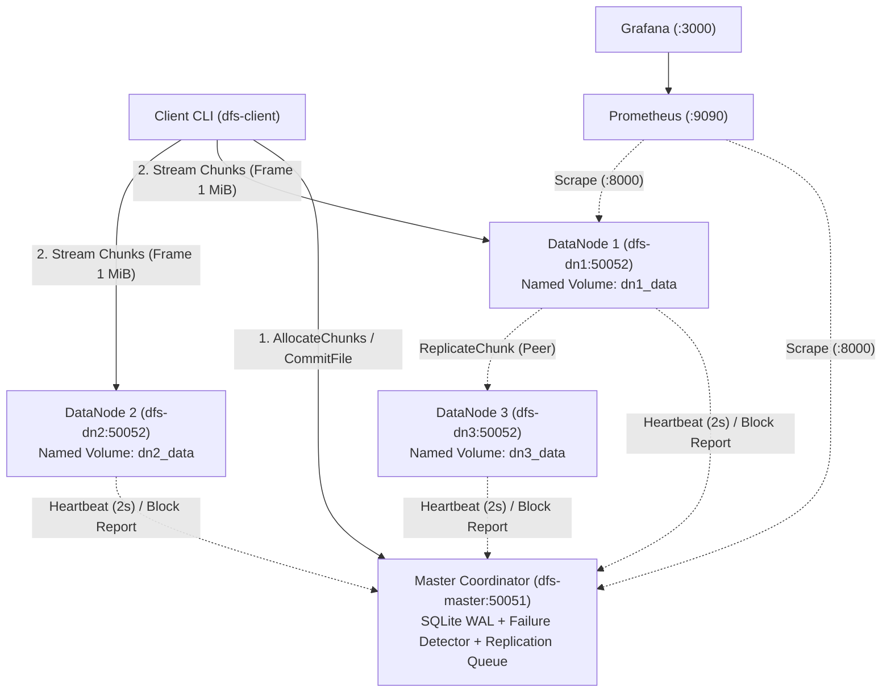

# DFS-X Terminal — Mini Distributed File System

> **Tema 5:** Cloud-based Distributed File Storage (DFS-X)  
> **Mata Kuliah:** Komputasi Paralel dan Terdistribusi (3 SKS) — UAS Ganjil 2026/2027  
> **Stack:** Python 3.12 (Pure) · gRPC Streaming · Podman/WSL2 · SQLite WAL · Prometheus & Grafana

DFS-X Terminal adalah implementasi sistem berkas terdistribusi mini berbasis CLI, gRPC streaming, dan arsitektur container. Proyek ini mendemonstrasikan koordinasi master-worker, replikasi data dengan anti-affinity ($RF=2$), verifikasi integritas data berbasis SHA-256 bertingkat, pemulihan mandiri saat kegagalan (*fault recovery*), pengujian skalabilitas (2 hingga 16 node), serta visualisasi metrik performa sesuai standar evaluasi ilmiah.

---

## 📋 Daftar Isi

1. [Fitur Utama & Arsitektur](#-fitur-utama--arsitektur)
2. [Topologi Cluster](#-topologi-cluster)
3. [Prasyarat Sistem](#-prasyarat-sistem)
4. [Panduan Mulai Cepat (Quickstart)](#-panduan-mulai-cepat-quickstart)
   - [Clone Repository](#1-clone-repository)
   - [Persiapan Lingkungan Virtual & Dependensi](#2-persiapan-lingkungan-virtual--dependensi)
   - [Kompilasi Protobuf gRPC](#3-kompilasi-protobuf-grpc)
   - [Build Container Image](#4-build-container-image)
5. [Menjalankan Cluster DFS-X](#-menjalankan-cluster-dfs-x)
   - [Menjalankan Cluster Default (1 Master + 3 DataNodes + 1 Client)](#menjalankan-cluster-default-1-master--3-datanodes--1-client)
   - [Memeriksa Status & Kesiapan Cluster](#memeriksa-status--kesiapan-cluster)
6. [Operasi CLI (Upload, Download, Verifikasi)](#-operasi-cli-upload-download-verifikasi)
   - [Generate Dataset Pengujian](#generate-dataset-pengujian)
   - [Upload & Download Berkas](#upload--download-berkas)
   - [Pemeriksaan Metadata & Verifikasi Integritas](#pemeriksaan-metadata--verifikasi-integritas)
7. [Pengujian Toleransi Kegagalan (Fault Tolerance F1–F6)](#-pengujian-toleransi-kegagalan-fault-tolerance-f1f6)
8. [Benchmarking & Skalabilitas (2 hingga 16 Node)](#-benchmarking--skalabilitas-2-hingga-16-node)
   - [Eksekusi Matriks Benchmark](#eksekusi-matriks-benchmark)
   - [Generasi 9 Grafik Analisis Ilmiah](#generasi-9-grafik-analisis-ilmiah)
9. [Monitoring Stack (Prometheus & Grafana)](#-monitoring-stack-prometheus--grafana)
10. [Pemeliharaan & Pembersihan Resource Disk](#-pemeliharaan--pembersihan-resource-disk)
11. [Panduan Video Demo (Max 10 Menit)](#-panduan-video-demo-max-10-menit)
12. [Troubleshooting Umum](#-troubleshooting-umum)
13. [Kepatuhan & Aturan Teknis (Rules of Engagement)](#-kepatuhan--aturan-teknis-rules-of-engagement)

---

## 🚀 Fitur Utama & Arsitektur

- **Master Coordinator:** Mengelola alokasi chunk, deteksi kegagalan node via heartbeat monolitik (`time.monotonic()`), pemulihan replika otomatis berbasis antrean (`queue.Queue`), dan metadata ACID menggunakan SQLite WAL.
- **Worker (DataNode):** Menyimpan chunk sebesar 8 MiB dengan penulisan atomik (`.tmp` + `os.replace`), penolakan alokasi otomatis jika disk rendah (`MIN_FREE_MB`), streaming chunk antar-node (*peer replication*), dan pelaporan berkala (*block report*).
- **Client CLI:** Pengunggahan dan pengunduhan multi-worker konkuren menggunakan gRPC streaming 1 MiB frame, verifikasi checksum bertingkat (SHA-256 per chunk dan per berkas), serta failover unduhan dinamis jika primer offline atau terjadi *checksum mismatch*.
- **Parameter Evaluasi Lengkap:** Mengukur dan memvisualisasikan 6 metrik wajib: Speedup Ratio ($S$), Efficiency ($E$), Throughput (MiB/s & task/detik), Latency (avg, p50, p95, p99), Fault Recovery, dan Skalabilitas (2, 3, 4, 8, 16 node).

---

## 🏗 Topologi Cluster



---

## 💻 Prasyarat Sistem

- **OS:** Windows 10/11 (dengan WSL2 aktif) atau Linux.
- **Container Engine:** [Podman](https://podman.io/) (v4.x/5.x/6.x) dengan `podman-compose`.
- **Python:** Python 3.12+ (disarankan) pada host untuk skrip visualisasi dan orchestrator benchmark.

---

## ⚡ Panduan Mulai Cepat (Quickstart)

### 1. Clone Repository

```bash
git clone https://github.com/Raka-coder/mini-dfs-container.git
cd dfs-x
```

### 2. Persiapan Lingkungan Virtual & Dependensi

Siapkan environment Python pada mesin host untuk menjalankan skrip pengujian, benchmark, dan visualisasi:

```bash
# Windows (PowerShell)
python -m venv .venv
.venv\Scripts\activate

# Linux / WSL2 (Bash)
python3 -m venv .venv
source .venv/bin/activate

# Install dependensi
pip install -r requirements.txt -r requirements-build.txt
pip install podman-compose matplotlib pandas ruff pytest
```

### 3. Kompilasi Protobuf gRPC

Generate stubs gRPC Python dari berkas definisi protokol:

```bash
python -m grpc_tools.protoc -I. --python_out=. --grpc_python_out=. proto/dfs.proto
```

### 4. Build Container Image

Bangun satu image terpadu `localhost/dfsx:latest` untuk seluruh layanan (Master, DataNode, Client):

```bash
podman build -t localhost/dfsx:latest .
```
*(Alternatif menggunakan helper Python: `python scripts/cluster.py build`)*

---

## 🐳 Menjalankan Cluster DFS-X

### Menjalankan Cluster Default (1 Master + 3 DataNodes + 1 Client)

Jalankan container cluster menggunakan Podman Compose:

```bash
podman-compose -p dfsx up -d
```
*(Atau menggunakan helper cross-platform: `python scripts/cluster.py up --nodes 3`)*

### Metode Deploy Stabil (WSL2 / Podman Windows)

Di lingkungan Podman Windows (WSL2 backend) komponen `aardvark-dns` sering gagal start sehingga `podman-compose` tidak bisa resolve nama container. Metode yang terbukti stabil adalah **menjalankan container satu per satu dengan `--network dfsnet` (tanpa DNS)**, di mana setiap container mendapat static IP dan entri `/etc/hosts` via `--add-host`. Orkestrator ini sudah diimplementasikan di `scripts/cluster.py`:

```bash
python scripts/cluster.py build                  # build image localhost/dfsx:latest
python scripts/cluster.py down -v               # bersihkan cluster + volume
python scripts/cluster.py up --nodes 3          # 1 master + 3 datanode + 1 client
python scripts/cluster.py up --nodes 16         # skalabilitas hingga 16 node
```

Network `dfsnet` dibuat dengan `--disable-dns --subnet 10.90.0.0/24`; master di `10.90.0.13`, datanode `10.90.0.14..`, client `10.90.0.14+N`. Semua container mendapat `--add-host` untuk tiap nama sehingga resolusi nama berfungsi tanpa DNS. **Gunakan metode ini** untuk eksperimen; `podman-compose` hanya referensi.

### Memeriksa Status & Kesiapan Cluster

Pastikan seluruh node telah terhubung dan berstatus `ALIVE`:

```bash
# Tunggu hingga master mendeteksi minimal 3 node aktif
podman exec dfs-client python -m client.cli wait-ready --min-nodes 3 --timeout 60

# Cek tabel status cluster
podman exec dfs-client python -m client.cli status
```

---

## 📦 Operasi CLI (Upload, Download, Verifikasi)

Semua operasi klien dieksekusi secara terisolasi di dalam container `dfs-client`:

### Generate Dataset Pengujian

```bash
# Profil lite (10 berkas x 5 MB sparse) untuk verifikasi cepat
podman exec dfs-client python -m client.cli gen-data --profile lite

# Profil full (100 berkas x 50 MB data acak nyata / os.urandom untuk benchmark final)
podman exec dfs-client python -m client.cli gen-data --profile full --batch 20
```

### Upload & Download Berkas

```bash
# Upload berkas tunggal
podman exec dfs-client python -m client.cli upload /work/testdata/f001.bin f001.bin

# Download berkas kembali
podman exec dfs-client python -m client.cli download f001.bin /work/out_000.bin

# List seluruh berkas di DFS-X
podman exec dfs-client python -m client.cli ls
```

### Pemeriksaan Metadata & Verifikasi Integritas

```bash
# Tampilkan detail alokasi chunk dan letak replika anti-affinity
podman exec dfs-client python -m client.cli info f001.bin

# Verifikasi integritas checksum SHA-256 berkas
podman exec dfs-client python -m client.cli verify f001.bin

# Hapus berkas
podman exec dfs-client python -m client.cli rm f001.bin
```

---

## 🛡 Pengujian Toleransi Kegagalan (Fault Tolerance F1–F6)

Pengujian skenario fault recovery otomatis dijalankan melalui modul [scripts/fault_test.py](file:///C:/dfs-x/scripts/fault_test.py):

| Skenario | Deskripsi Pengujian |
|---|---|
| **F1** | Node dimatikan saat upload sedang berlangsung $\rightarrow$ failover on-the-fly (`ReallocateChunk`). |
| **F2** | Node mati $\rightarrow$ auto re-replication $\rightarrow$ node lain mati $\rightarrow$ file tetap utuh dan dapat diunduh. |
| **F3** | Node kembali menyala $\rightarrow$ pengiriman *full block report* & pembersihan replika berlebih (*trimming*). |
| **F4** | Unduh file saat salah satu node penyimpanan berstatus `DOWN` $\rightarrow$ failover ke replika sekunder. |
| **F5** | Modifikasi 1 byte chunk di disk secara sengaja $\rightarrow$ deteksi `CHECKSUM_MISMATCH` & fallback. |
| **F6** | Restart master node saat cluster beroperasi $\rightarrow$ integritas metadata SQLite WAL tetap terjaga. |

Jalankan test suite:
```bash
python -m scripts.fault_test --scenario f1
# Atau jalankan otomatis seluruh skenario fault
python -m scripts.fault_test
```
Rekapitulasi waktu deteksi dan perbaikan akan tersimpan di `results/fault_summary.csv`.

---

## 📊 Benchmarking & Skalabilitas (2 hingga 16 Node)

### Eksekusi Matriks Benchmark

Untuk menguji performa throughput, latensi, speedup, dan efisiensi:

```bash
# Jalankan benchmark Tier 1 (Quick verification pada cluster aktif)
python -m scripts.bench_matrix --tier 1

# Jalankan pengujian skalabilitas (2, 3, 4, 8, 16 DataNodes)
python scripts/gen_compose.py --nodes 16 --out docker-compose.gen.yml --dn-mem 128m --dn-cpus 0.25 --dn-workers 4
podman-compose -p dfsx -f docker-compose.gen.yml up -d
python -m scripts.bench_matrix --tier 2
```

### Generasi 9 Grafik Analisis Ilmiah

Hasilkan seluruh visualisasi siap pakai untuk paper/laporan IEEE (resolusi 150 DPI):

```bash
python scripts/plots.py
```

Grafik akan dihasilkan di direktori [results/plots/](file:///C:/dfs-x/results/plots/):
1. `speedup_vs_workers.png` ($S = T_{seq} / T_{par}$)
2. `efficiency_vs_workers.png` ($E = S / P$)
3. `throughput_vs_nodes.png` (Throughput agregat MiB/s)
4. `tasks_per_sec.png` (Throughput task per detik)
5. `latency_per_op.png` (Distribusi rata-rata, p50, p95, p99)
6. `scalability_nodes.png` (Skalabilitas node 2 s/d 16)
7. `recovery_timeline.png` (Waktu deteksi failure & durasi re-replikasi)
8. `storage_per_node.png` (Keseimbangan beban penyimpanan chunk)
9. `access_time.png` (Perbandingan waktu akses sekuensial vs paralel)

---

## 📈 Monitoring Stack (Prometheus & Grafana)

Proyek ini menyertakan bonus monitoring stack dengan dashboard siap pakai. Karena port publish
tidak berfungsi di VM Podman Windows ini, gunakan **Metode Deploy Stabil** + SSH tunnel.

### 1. Jalankan (Metode Deploy Stabil)

Prometheus & Grafana harus berada di network `dfsnet` yang sama dengan cluster, dengan IP statis
dan entri `/etc/hosts` (DNS dinonaktifkan). Image di-pull otomatis:

```bash
podman rm -f dfs-prometheus dfs-grafana
podman run -d --name dfs-prometheus --hostname dfs-prometheus --cgroups disabled \
  --network dfsnet --ip 10.90.0.30 \
  --add-host dfs-master:10.90.0.13 --add-host dfs-dn1:10.90.0.14 \
  --add-host dfs-dn2:10.90.0.15 --add-host dfs-dn3:10.90.0.16 \
  --add-host dfs-grafana:10.90.0.31 \
  -v /mnt/c/dfs-x/monitoring/prometheus.yml:/etc/prometheus/prometheus.yml:ro \
  -p 9090:9090 docker.io/prom/prometheus:v2.55.1 \
  --config.file=/etc/prometheus/prometheus.yml --storage.tsdb.retention.time=2h

podman run -d --name dfs-grafana --hostname dfs-grafana --cgroups disabled \
  --network dfsnet --ip 10.90.0.31 \
  --add-host dfs-master:10.90.0.13 --add-host dfs-dn1:10.90.0.14 \
  --add-host dfs-dn2:10.90.0.15 --add-host dfs-dn3:10.90.0.16 \
  --add-host dfs-prometheus:10.90.0.30 \
  -e GF_AUTH_ANONYMOUS_ENABLED=true -e GF_AUTH_ANONYMOUS_ORG_ROLE=Admin \
  -e GF_ANALYTICS_REPORTING_ENABLED=false \
  -v /mnt/c/dfs-x/monitoring/grafana/provisioning:/etc/grafana/provisioning:ro \
  -v /mnt/c/dfs-x/monitoring/grafana/dashboards:/var/lib/grafana/dashboards:ro \
  -p 3000:3000 docker.io/grafana/grafana:11.3.0
```

Verifikasi (dari dalam container, karena port publish tidak berfungsi ke host):
```bash
podman exec dfs-prometheus wget -qO- http://localhost:9090/-/healthy
podman exec dfs-grafana wget -qO- http://localhost:3000/api/health
```

### 2. Akses dari host (SSH tunnel)

Port publish `9090`/`3000` tidak bisa dijangkau langsung dari host. Buka tunnel ke VM:

```powershell
ssh -i "$env:USERPROFILE\.local\share\containers\podman\machine\machine" -p 54345 `
  -o StrictHostKeyChecking=no -o UserKnownHostsFile=NUL `
  -L 3000:10.90.0.31:3000 -L 9090:10.90.0.30:9090 -N user@localhost
```

Biarkan terminal tunnel tetap terbuka, lalu akses di browser host:
- **Prometheus UI:** `http://localhost:9090` (targets master + 3 datanode, semua UP)
- **Grafana UI:** `http://localhost:3000` (anonymous Admin, dashboard `DFS-X` otomatis terprovisi)

Target scrape di `monitoring/prometheus.yml` memakai nama kontainer aktual: `dfs-master:8000`,
`dfs-dn1..3:8000` (bukan `master`/`datanode1`).

### 3. Matikan

```bash
# tutup tunnel (Ctrl+C), lalu
podman rm -f dfs-prometheus dfs-grafana
```

---

## 🧹 Pemeliharaan & Pembersihan Resource Disk

Untuk menjaga headroom disk dan menghindari pembengkakan container volume:

```bash
# Matikan cluster dan hapus volume
podman-compose -p dfsx down -v
podman-compose -p dfsx-mon -f docker-compose.monitoring.yml down -v

# Pembersihan menyeluruh sistem podman
podman system prune -a --volumes -f
```

---

## 🎬 Panduan Video Demo (Max 10 Menit)

Struktur presentasi video (max 10 menit):

- **0–1 mnt — Topologi:** tampilkan `podman ps`, arsitektur 1 master + N datanode + client, network `dfsnet` dengan static IP.
- **1–3 mnt — Upload & Verify:** `gen-data --profile lite`, `upload /work/testdata/f001.bin f001.bin`, `info f001.bin` (tunjukkan 2 replika di node berbeda — anti-affinity), `verify f001.bin`.
- **3–6 mnt — Kill-node demo & auto-recovery:** `stop dfs-dn1`, upload file besar, master menandai node DOWN, realokasi otomatis, `start dfs-dn1`, tunggu re-replication, `status` kembali sehat.
- **6–8 mnt — Grafik performa:** tampilkan 7 plot di `results/plots/` (speedup, efficiency, throughput vs nodes, scalability, tasks/s, latency, recovery timeline).
- **8–10 mnt — Kesimpulan:** ringkasan pencapaian (RF=2, anti-affinity, fault recovery F1–F6, skalabilitas 2–16 node), keterbatasan hardware (2 GB RAM VM).

## 🔧 Troubleshooting Umum

- **grpcio build fail / `protoc` error:** pastikan `.venv` Python 3.12 aktif; regenerasi stub dengan `python -m grpc_tools.protoc -I. --python_out=. --grpc_python_out=. proto/dfs.proto`. Protobuf stub (`proto/dfs_pb2*.py`) sengaja di-gitignore.
- **Podman cgroup error (`cannot bind`, `conmon` state):** jangan pakai `--memory`/`--cpus` pada `podman run` di VM ini; gunakan `scripts/cluster.py` yang sudah `--cgroups=disabled`. Jika machine rusak: `podman machine stop` → `podman machine rm` → `podman machine init --cpus 4 --memory 4096` → `podman machine start`.
- **aardvark-dns gagal start:** gunakan `scripts/cluster.py` (network `--disable-dns` + static IP + `--add-host`), jangan patch `docker-compose.yml`.
- **Node DOWN:** cek `podman ps`, restart container (`podman start dfs-dnN`), tunggu heartbeat (timeout 10 s, scan 2 s). Master menandai DOWN setelah 10 s tanpa heartbeat.
- **RESOURCE_EXHAUSTED / DISK_LOW:** storage sisa 28 GB. Profil `full` = 100×50 MB (RF=2 → ~10 GB/run); gunakan profil `lite` untuk 8/16 node. Jalankan `rm --all` antar run. `DeleteFile` kini menghapus chunk di datanode (sebelumnya metadata saja).
- **Master tidak reachable dari host:** port publish 50051 tidak berfungsi di VM ini; jalankan benchmark via `podman exec dfs-client python -m scripts.bench_matrix`.
- **Protobuf version warning:** gencode 5.27.2 vs runtime 5.28.2 — warning, bukan error; abaikan.

---

## 🛡 Kepatuhan & Aturan Teknis (Rules of Engagement)

- **Zero `print()`:** Seluruh logging wajib menggunakan modul standard `logging`. Validasi melalui:
  ```bash
  python scripts/check_no_print.py
  ```
- **Unit Test Sanity:**
  ```bash
  python -m pytest tests -v
  ```
- **Code Formatting & Linting:**
  ```bash
  ruff check . ; ruff format --check .
  ```
